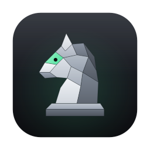
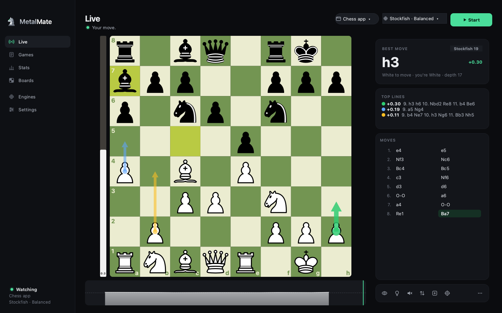
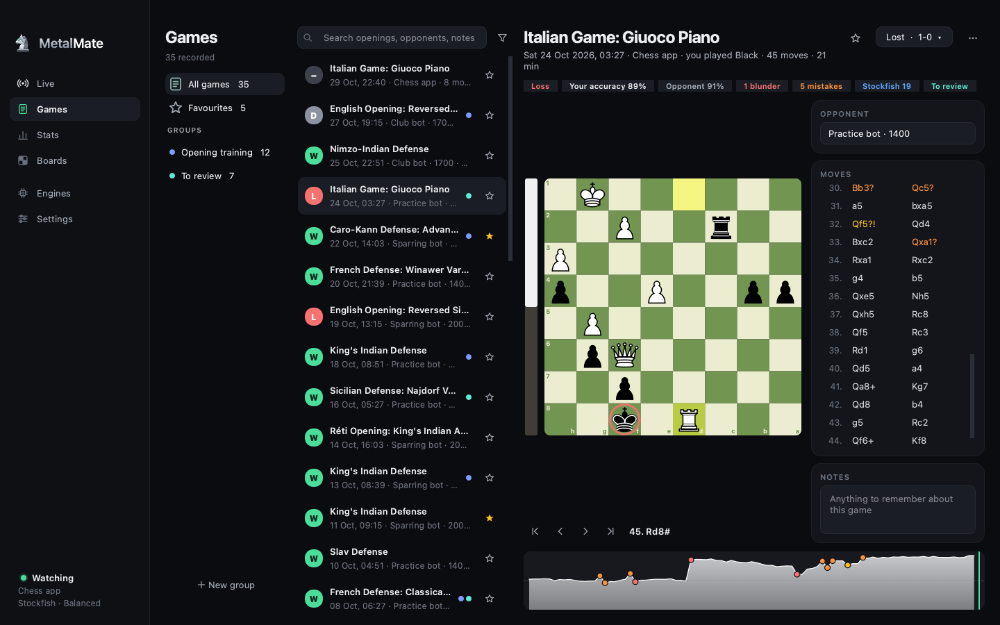
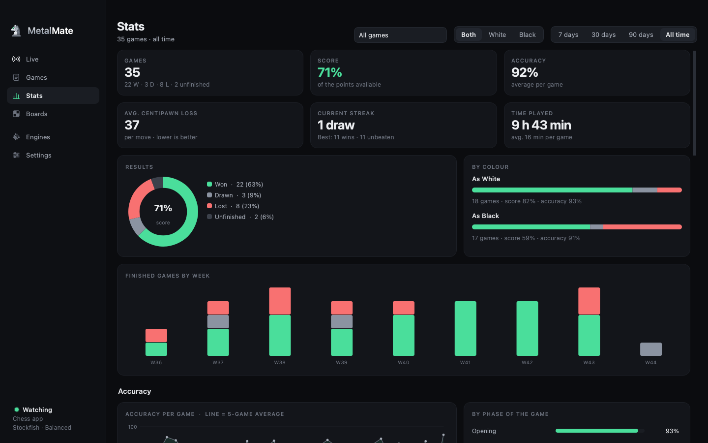
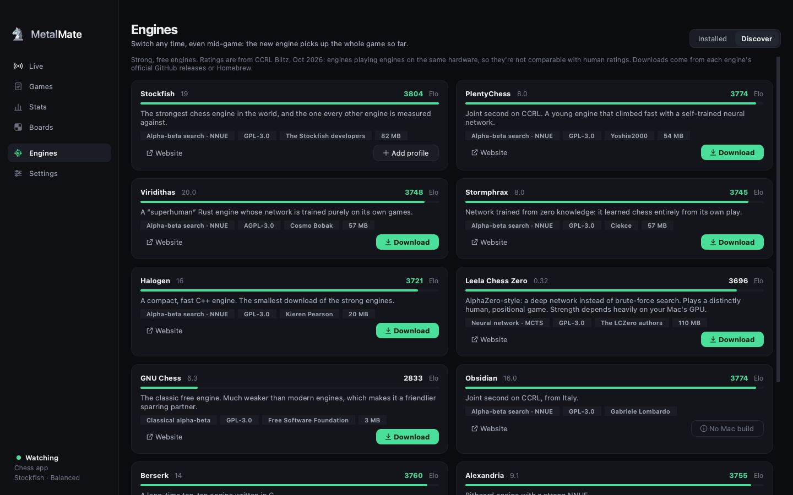
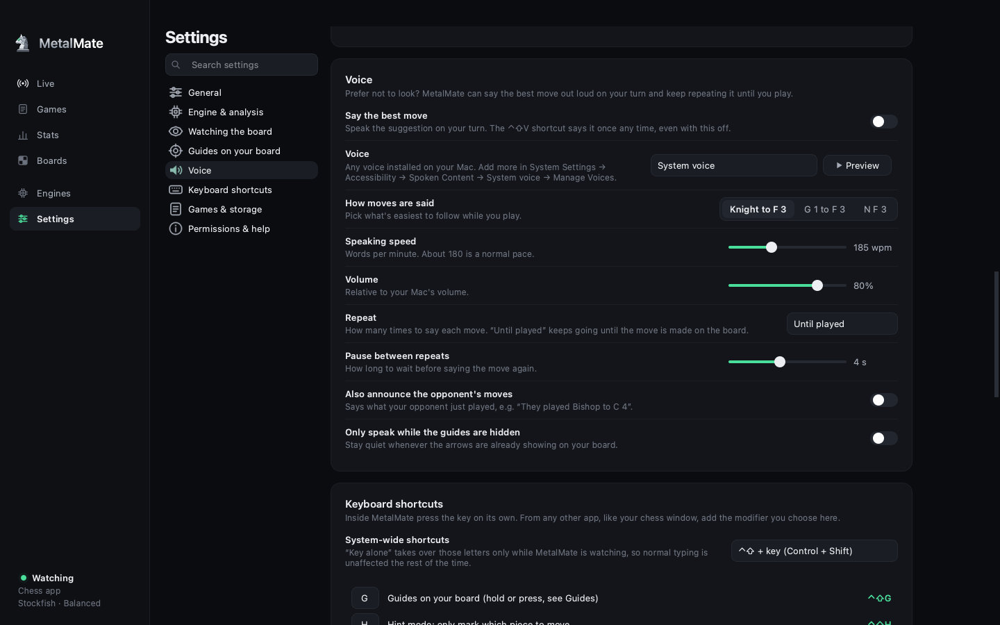

<p align="center">
  
</p>

<h1 align="center">MetalMate</h1>

<p align="center">
  <b>See the board. Find the move.</b><br>
  A screen-reading chess companion for the Mac. It follows the game on a chessboard on your screen and shows
  the engine's best move on its own board, as arrows over your board, or out loud.
</p>

<p align="center">
  <a href="https://github.com/Ranbo-codez/MetalMate/releases/latest/download/MetalMate.dmg"><b>Download for Mac</b></a>
  ·
  <a href="#build-it-yourself">Build from source</a>
</p>

<p align="center">
  
  
  
</p>

<p align="center"></p>

> **Fair play.** MetalMate is for practice, studying, analysing your own games and playing against bots.
> Using engine help in games against other people is cheating on every chess site and over the board.
> Please don't.

## What it does

- **Follows the board in any window.** Pick a window (a chess site in your browser, a desktop chess app or the
  built-in practice board). MetalMate finds the board inside it, learns the board's colours and pieces from the
  starting position, and tracks every move. It works from screenshots of that one window at an interval you set,
  and never records video.
- **Shows the best move your way.** On its own board with the top lines and an evaluation graph; as click-through
  arrows drawn over your real board (hold a key to peek, toggle them, or keep them on); or spoken out loud.
- **Many engines.** Stockfish works out of the box. The *Discover* tab lists strong free engines with their CCRL
  ratings and installs them in one click. Make profiles (think time, threads, memory, limited strength) and switch
  between them any time, even mid-game: the new engine picks up the whole game so far.
- **Keeps up with the game.** Switch tabs, check your email, come back: it's still the same game. Missed a few moves
  while you were away? MetalMate works out what was played. Animations and half-drawn frames don't turn into
  phantom moves.
- **Your game library.** Every game is saved with moves and evaluations. Replay games, see blunders and accuracy,
  add opponents and notes, organise games into groups and favourites, and export as PGN.
- **Stats that mean something.** Score by colour, accuracy trend and by phase, blunders per 100 moves, where your
  mistakes happen and with which piece, openings, opponents, comebacks, streaks and personal bests.
- **Mac-native and private.** Global shortcuts and a menu-bar icon. Everything stays on your Mac.

| Games | Stats |
|---|---|
|  |  |

| Engines | Settings |
|---|---|
|  |  |

## Download and install

**Needs:** a Mac with Apple Silicon (M1 or later) and macOS 12 Monterey or later.

1. Download **[MetalMate.dmg](https://github.com/Ranbo-codez/MetalMate/releases/latest/download/MetalMate.dmg)**
   from the [latest release](https://github.com/Ranbo-codez/MetalMate/releases/latest).
2. Open it and drag **MetalMate** into **Applications**.
3. Open MetalMate. The app isn't notarised by Apple yet, so the first time macOS says it can't check it for
   malicious software. Click **Done**, open **System Settings → Privacy & Security**, scroll down and click
   **Open Anyway** next to MetalMate, then confirm. You only need to do this once.
4. When asked, allow MetalMate under **Screen & System Audio Recording**, then quit and reopen it (macOS applies the
   permission after a restart).

If you'd rather not trust a downloaded app, [build it yourself](#build-it-yourself): every line of code is here.

## First run

A short setup guide walks you through it:

1. **Screen Recording.** Allow MetalMate under *System Settings → Privacy & Security → Screen & System Audio
   Recording*, then relaunch it.
2. **Engine.** Stockfish is found automatically if it's installed (`brew install stockfish`); otherwise install it
   in one click from *Engines → Discover*.
3. **Your board.** Choose the window with your chessboard. When it shows the starting position, MetalMate learns
   the board by itself (or press *Calibrate*, ⌃⇧C).

Then press **Start**. *Settings → Permissions & help → Test my setup* checks everything end to end on the built-in
practice board.

## Keyboard shortcuts

Inside MetalMate press the key on its own. From any other app add the modifier chosen in Settings (⌃⇧ by default).
Every key can be changed.

| Key | Action |
|---|---|
| ⌃⇧G | Show the best move on your board (hold, toggle or always on, your choice) |
| ⌃⇧V | Say the best move out loud |
| ⌃⇧H | Hint mode: only mark which piece to move |
| ⌃⇧S | Start / stop watching |
| ⌃⇧N | Start a new game |
| ⌃⇧F | Flip the board orientation |
| ⌃⇧L | Number of arrows: 1 → 2 → 3 |
| ⌃⇧E | Show / hide the evaluation bar |
| ⌃⇧B | Suggest for me only / both sides |
| ⌃⇧C | Calibrate (board in the starting position) |
| ⌘1 … ⌘6 | Live, Games, Stats, Boards, Engines, Settings |

## Engines

Any [UCI](https://www.chessprogramming.org/UCI) engine works: add it with *Engines → Add from file…*. The
*Discover* tab installs these directly from their official releases or Homebrew:

| Engine | CCRL Blitz | Style |
|---|---|---|
| Stockfish 19 | 3804 | Alpha-beta search · NNUE |
| PlentyChess 8 | 3774 | Alpha-beta search · NNUE |
| Viridithas 20 | 3748 | Alpha-beta search · NNUE |
| Stormphrax 8 | 3745 | Alpha-beta search · NNUE |
| Halogen 16 | 3721 | Alpha-beta search · NNUE |
| Leela Chess Zero 0.32 | 3696 | Neural network · MCTS |
| GNU Chess 6.3 | 2833 | Classical alpha-beta |

Ratings are engine-vs-engine on fixed hardware ([CCRL](https://computerchess.org.uk/ccrl/404/), October 2026) and
aren't comparable with human ratings. Engines are separate programs under their own licences; MetalMate doesn't
bundle any.

## How it works

1. **Capture.** At each interval MetalMate grabs only the chosen window with `CGWindowListCreateImage`, even when it
   sits behind other windows. It looks more often while waiting for the opponent's move.
2. **Find the board.** The board is located by its 8×8 grid of alternating squares and found again automatically
   if the window moves or resizes.
3. **Recognise pieces.** Calibration on the starting position learns each square colour and every piece's
   silhouette from your board. Each square is then classified against those templates.
4. **Follow the game.** A new position must be seen in two screenshots before it counts, so a piece caught
   mid-slide is never taken for a move. Positions are then matched against legal continuations, including several
   missed moves. If MetalMate isn't sure of the position, it clears the arrows instead of showing outdated ones.
5. **Ask the engine.** The position goes to the selected UCI engine profile; results flow to the Live page, the
   arrows and the voice.

The arrows on your board are drawn by a small helper process (`MetalMate Guides`) with no Dock icon. MetalMate's
chess rules, notation and engine communication are its own code (`metalmate/mmchess`).

## Your data

Everything lives on your Mac:

- `~/Library/Application Support/MetalMate/`: settings, engines, board profiles and the game library (SQLite).
- `~/Documents/MetalMate Games/`: each game as a text file with its PGN (optional).

Nothing is uploaded. The only network access is downloading an engine when you ask for one.

## Build it yourself

You need an Apple Silicon Mac and Python 3.13 from [python.org](https://www.python.org/downloads/macos/).

```bash
git clone https://github.com/Ranbo-codez/MetalMate.git
cd MetalMate
./packaging/build_app.sh --dmg        # dist/MetalMate.app and dist/MetalMate-<version>.dmg
```

`--install` also copies the app to `/Applications`. To run from source instead:

```bash
python3 -m venv .venv
.venv/bin/pip install -r requirements.txt
.venv/bin/python -m metalmate
```

### Development

```bash
.venv/bin/python -m unittest discover -s tests -t .      # the test suite (runs offscreen)
.venv/bin/python scripts/make_screenshots.py             # regenerate the screenshots
```

```
metalmate/
  app.py           entry point: splash, window, first-run setup
  session.py       the live loop: capture → recognise → track → analyse → show
  vision.py        board finding, calibration and piece recognition
  tracker.py       turning recognised positions into legal moves
  mmchess/         chess rules, SAN/FEN, PGN and the UCI engine protocol
  engine.py        UCI engine worker thread
  engines.py       installed engines, profiles and installers
  catalog.py       the Discover list
  storage.py       game library (SQLite), groups, PGN
  stats.py         statistics for the Stats page
  speech.py        spoken moves
  overlay*.py      the click-through arrows on your board
  ui/              pages, design system, logo, splash and setup guide
tests/             unit and end-to-end tests
packaging/         PyInstaller spec, launcher, build script, licence notices
```

See [CONTRIBUTING.md](CONTRIBUTING.md) for how to help.

## License

**MetalMate is created by Ranbir Dhall** and is free for non-commercial use under the
[PolyForm Noncommercial License 1.0.0](LICENSE). In plain words (the [licence text](LICENSE) is what counts):

- ✅ Download it, use it, study the code and change it, for free.
- ✅ Share it, or your changed version, for free.
- ✅ Use parts of it in your own non-commercial projects.
- ❌ Don't sell it or a changed version, and don't use it for any commercial purpose.
- 📝 Whatever you share, including any part of the code, must include the licence and its
  `Required Notice` lines: *Copyright (c) 2026 Ranbir Dhall*, crediting Ranbir Dhall as MetalMate's creator.

Because it forbids commercial use, this licence is "source-available" rather than "open source" in the
[OSI](https://opensource.org/osd) sense. For a commercial licence, open an issue.

The app bundles third-party software under its own licences: Python (PSF), Qt and Qt for Python (LGPL-3.0), NumPy,
Pillow, python-mss, PyObjC and the Cburnett chess pieces (BSD). Their full texts are in
[THIRD_PARTY_NOTICES.txt](THIRD_PARTY_NOTICES.txt) and [licenses/](licenses/).

<p align="center"><sub>MetalMate · made by Ranbir Dhall</sub></p>
